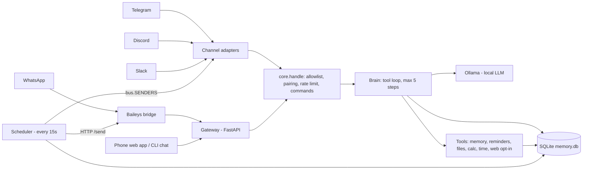
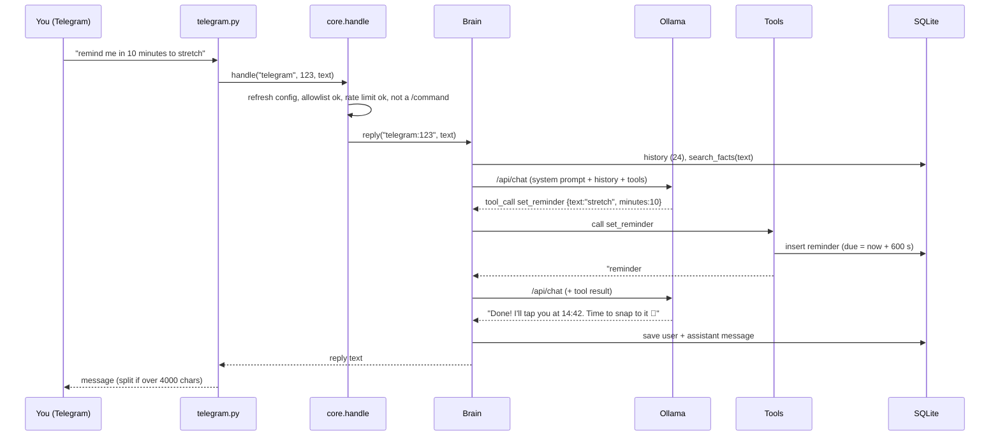

<h1 align="center">🦞 NarzXclaw</h1>
<p align="center"><b>A private, local-first personal AI assistant that lives in your chat apps.</b><br>
Brain, memory and voice run on your own machine. Message it from Telegram, Discord, Slack, WhatsApp, your phone's browser, or your terminal.</p>

<p align="center">
<a href="https://github.com/YOUR-USERNAME/narzxclaw">GitHub</a> ·
<a href="docs/index.html">Docs (English · Bahasa Indonesia · Español · हिन्दी)</a> ·
<a href="CHANGELOG.md">Changelog</a>
</p>

---

## Table of contents

1. [What is NarzXclaw?](#1-what-is-narzxclaw)
2. [Architecture](#2-architecture)
3. [Simulation: the life of a message](#3-simulation-the-life-of-a-message)
4. [Quick start](#4-quick-start)
5. [Connecting chat apps](#5-connecting-chat-apps)
6. [Voice and phone access](#6-voice-and-phone-access)
7. [Tools reference](#7-tools-reference)
8. [Commands](#8-commands)
9. [Configuration reference](#9-configuration-reference)
10. [Running it always-on](#10-running-it-always-on)
11. [Security and privacy model](#11-security-and-privacy-model)
12. [Troubleshooting](#12-troubleshooting)
13. [FAQ](#13-faq)
14. [Project layout](#14-project-layout)
15. [Development and testing](#15-development-and-testing)
16. [Known limitations and roadmap](#16-known-limitations-and-roadmap)
17. [Contributing and license](#17-contributing-and-license)

---

## 1. What is NarzXclaw?

NarzXclaw is a personal assistant you run yourself. It answers in the chat apps you already use, remembers things about you,
sets reminders that arrive in the same chat, keeps notes in a private folder, and can talk by voice from your phone.
Its personality is a quirky lobster 🦞 (switchable).

**Design principles**

| Principle | What it means in practice |
|---|---|
| Local brain | The language model runs in [Ollama](https://ollama.com) on your hardware. No cloud AI API key is needed. |
| Your data stays yours | Chats, memories and reminders live in one SQLite file. `narzxclaw export` takes it out, `narzxclaw wipe` deletes it. |
| No inbound exposure | Telegram, Slack and Discord connect *outbound*. The gateway listens on `127.0.0.1` only. No open ports, no public URL. |
| Strangers get nothing | Only approved senders are answered. Everyone else receives a one-time pairing code that only you can approve. |
| Always on | Each chat connection is supervised and restarts itself; a background service keeps the whole thing running. |
| Honest about limits | Web access is off by default; the docs say plainly what is and isn't local (see [§11](#11-security-and-privacy-model)). |

**Feature overview**

- Chat apps: Telegram, Discord, Slack, WhatsApp (unofficial), plus a phone-friendly web app and a terminal chat.
- Voice: voice notes (Telegram, WhatsApp, Discord) and tap-to-talk in the web app; offline speech-to-text (faster-whisper) and text-to-speech (Piper).
- Tools: long-term memory, reminders, private files, calculator, clock, and opt-in web search/fetch.
- Personalities: `lobster`, `captain`, `zen`, `pro`; replies in the language you write in.
- Operations: guided `onboard`, `doctor`, hot-reloaded allowlists, systemd/launchd service, Docker Compose.

---

## 2. Architecture

### 2.1 Big picture

```
                       ┌───────────────────────── your machine ──────────────────────────┐
                       │                                                                   │
 Telegram ──(poll)────►│  channels/telegram.py ─┐                                          │
 Discord  ──(gateway)─►│  channels/discord.py  ─┤                                          │
 Slack    ──(socket)──►│  channels/slack.py    ─┼──► core.handle() ──► Brain ──► Ollama    │
 WhatsApp ─► Baileys ─►│  channels/whatsapp.py ─┤   ▲  allowlist       │  ▲     (local LLM) │
            bridge     │     (HTTP to gateway)  │   │  pairing         │  └── Tools         │
 Phone/Web ───────────►│  gateway.py (FastAPI) ─┘   │  rate limit      │      memory        │
 Terminal (chat) ──────┼────────────────────────────┘  commands        │      reminders     │
                       │                                               ▼      files         │
                       │   scheduler.py ──► bus.SENDERS ──► (push)   SQLite    calc/time    │
                       │   (due reminders)                           memory.db  web (opt-in)│
                       └───────────────────────────────────────────────────────────────────┘
```



### 2.2 Components

| File | Responsibility |
|---|---|
| `cli.py` | The `narzxclaw` command: onboard, run, chat, doctor, approve, allow, link, voice-setup, token, service, export, wipe. |
| `runner.py` | Starts the gateway, the scheduler and every enabled channel. `supervise()` restarts a crashed channel with exponential backoff (5 s up to 300 s) without affecting the others. |
| `core.py` | `handle(channel, sender, text)`: the **single entry point** for every app. Hot-reloads config, checks the allowlist, issues pairing codes, rate-limits, parses slash commands, then calls the brain. Also `chunk()` for splitting long replies. |
| `brain.py` | Builds the prompt (persona + remembered facts + time + last 24 messages), calls Ollama `/api/chat`, runs the **tool loop** (up to 5 steps), stores only the user and final assistant message. Falls back to plain chat if the model lacks tool support. |
| `tools.py` | Tool registry and implementations. Only tools enabled in `config.tools` are offered to the model. Includes the safe calculator, workspace sandbox and SSRF guard. |
| `store.py` | SQLite access (see schema below). |
| `persona.py` | The four personalities and the system prompt template. |
| `scheduler.py` | Every 15 s, sends due reminders through `bus.SENDERS[channel]`. If that app is offline the reminder stays pending and retries on the next tick. |
| `bus.py` | Registry `channel -> async send(sender, text)`. Channels register after they connect; this is how proactive messages find their way out. |
| `gateway.py` | FastAPI app: web UI, token-authenticated JSON API, voice endpoints, and the endpoints the WhatsApp bridge calls. |
| `voice.py` | `transcribe()` with faster-whisper (int8), `speak()` with the Piper CLI. |
| `channels/*.py` | One adapter per app; they only translate between the app's API and `core.handle()`. |
| `bridges/whatsapp/` | Node.js process using Baileys; talks to the gateway over loopback HTTP and exposes `POST /send` on `gateway_port + 1`. |

### 2.3 Data model (`~/.narzxclaw/memory.db`)

| Table | Columns | Purpose |
|---|---|---|
| `msgs` | id, session, role, content, ts | Chat history; `session = "<channel>:<sender>"`. Last 24 messages are sent to the model. |
| `facts` | id, text, ts | Long-term memory; the most relevant facts (keyword match) are injected into every prompt. |
| `reminders` | id, channel, sender, text, due, done | Pending and delivered reminders. |
| `pending` | code, channel, sender, ts | Pairing codes (6 digits, 1 hour, at most 20 at once). |
| `prefs` | session, key, value | Per-chat settings such as the `/mode` personality. |

### 2.4 Concurrency model

Everything runs in one `asyncio` loop: the uvicorn server, the scheduler, and one task per enabled channel. Blocking work
(speech-to-text, text-to-speech, DNS checks) is pushed to threads with `asyncio.to_thread`. The WhatsApp bridge is a child
process; if it exits, `supervise()` restarts it.

### 2.5 Gateway API

All endpoints except `/` and `/manifest.webmanifest` require `Authorization: Bearer <token>` (`narzxclaw token`).

| Method and path | Use |
|---|---|
| `GET /api/info` | Model, persona, whether voice is on |
| `POST /api/chat` `{text}` | Web app chat (goes through `core.handle` as channel `web`) |
| `GET /api/inbox` | Web app polls for reminders every 15 s |
| `POST /api/voice` (multipart `audio`) | Voice turn: transcript, reply, base64 WAV |
| `POST /api/channel/{channel}` `{sender,text}` | Used by the WhatsApp bridge |
| `POST /api/channel/{channel}/audio` (`sender`, `audio`) | Voice notes from the bridge |

---

## 3. Simulation: the life of a message

Each trace below follows real code paths. Timings are illustrative.

### 3.1 A known user sets a reminder (Telegram)

> You: *remind me in 10 minutes to stretch*



1. **Telegram** delivers the update to `channels/telegram.py` (long polling, outbound only).
2. `core.handle` calls `config.refresh()` (so a just-approved sender works immediately), confirms the sender is allowed, applies the rate limit, and sees that the text is not a slash command.
3. `Brain.reply` assembles: persona prompt, current time, up to 6 relevant remembered facts, the last 24 messages, your text, and the list of enabled tools.
4. Ollama answers with a **tool call** instead of text. `Tools.call("set_reminder", ...)` inserts a row with `due = now + 600 s` and returns `reminder #7 set for 14:42`.
5. The result goes back to the model, which writes the final reply. The loop allows at most 5 model calls per message.
6. Only your message and the final reply are saved to history (tool chatter is not), then the reply is sent back, split into chunks if long.

### 3.2 …and ten minutes later (proactive message)

1. `scheduler.run` wakes every 15 s and asks the store for reminders with `due <= now` and `done = 0`.
2. It looks up `bus.SENDERS["telegram"]`, which the Telegram adapter registered when it connected.
3. It calls `send("123", "⏰ Reminder: stretch")`, then marks the row done. If Telegram is offline, nothing is marked and it retries 15 s later.

For WhatsApp the sender is an HTTP call to the bridge's local `POST /send`; for the web app it appends to an in-memory inbox that the page polls.

### 3.3 A stranger messages the bot

1. Sender `999` is not on the allowlist, so `core.handle` skips the brain entirely.
2. With `pairing: true`, the store creates (or reuses) a 6-digit code and the bot replies: *"Pairing code: 482913. Ask my owner to run `narzxclaw approve 482913`."*
3. You run `narzxclaw approve 482913`. The CLI resolves the code, adds the ID to `config.json` and saves.
4. The running process notices the file's modified time on the next message and reloads the allowlists. **No restart.**

No model call, no memory read, no tools: strangers cost you nothing and learn nothing.

### 3.4 A voice note (WhatsApp)

1. The Baileys bridge receives an `audioMessage`, downloads it and POSTs it to `/api/channel/whatsapp/audio`.
2. The gateway checks the sender is approved *before* transcribing, then runs faster-whisper in a worker thread (language auto-detected).
3. The transcript goes through the same `core.handle` path as typed text. The bridge sends back `🎙️ "transcript"` and then the reply.

### 3.5 Try the simulation yourself

- **Interactive:** open `docs/index.html` and scroll to *Architecture simulation*; pick a scenario and watch the packet travel node by node.
- **Terminal:** `narzxclaw chat` runs steps 2 to 6 of §3.1 with no accounts. Try `remind me in 1 minute to test`, then `/memory`.

---

## 4. Quick start

**Requirements:** Python 3.10+, [Ollama](https://ollama.com). Node.js 18+ only for WhatsApp. Roughly: 3B model ≈ 4 GB RAM, 8B ≈ 8 to 16 GB, 14B ≈ 16 GB or more.

| Your RAM | Suggested model (onboard picks this automatically) |
|---|---|
| under 8 GB | `llama3.2:3b` |
| 8 to 20 GB | `llama3.1:8b` |
| over 20 GB | `qwen2.5:14b` |

Tool calling needs a tool-capable model (Llama 3.1+, Qwen 2.5 and similar). Others still chat, without tools.

**A. Install script**
```bash
./install.sh
```
**B. pip**
```bash
pip install -e '.[voice]'     # drop [voice] if you don't need speech
narzxclaw onboard
narzxclaw run
```
**C. Docker**
```bash
docker compose run --rm narzxclaw onboard
docker compose exec ollama ollama pull llama3.1:8b
docker compose up -d
```

First test with **no accounts at all**: `narzxclaw chat`. Then run `narzxclaw doctor`.

---

## 5. Connecting chat apps

All of these need only outbound internet. After connecting, DM the bot; it replies with a pairing code; run `narzxclaw approve CODE`.

### Telegram
1. In Telegram, message **@BotFather** → `/newbot` → copy the token.
2. `narzxclaw onboard`, tick Telegram, paste the token.
3. Optional: pre-approve yourself with your numeric ID (from @userinfobot), or just use pairing.

### Discord
1. [discord.com/developers](https://discord.com/developers) → New Application → Bot → copy the token.
2. Enable **Message Content Intent** (required, or the bot sees empty messages).
3. Invite the bot to a server, or DM it. In servers it answers when mentioned; in DMs it always answers. Audio attachments are transcribed when voice is on.

### Slack
1. api.slack.com/apps → Create from scratch → enable **Socket Mode** → create an app token (`xapp-…`, scope `connections:write`).
2. Bot scopes: `chat:write`, `im:history`, `im:write`, `app_mentions:read`. Subscribe to events `message.im` and `app_mention`.
3. Install to workspace (`xoxb-…`). In *App Home*, enable the **Messages** tab so you can DM it.

### WhatsApp (unofficial)
1. Tick WhatsApp in `onboard` (installs the Node bridge), then run `narzxclaw link whatsapp`.
2. Scan the QR in *WhatsApp → Settings → Linked devices*, wait for `WhatsApp connected`, press Ctrl-C.
3. `narzxclaw run`. Text and voice notes work; reminders go out through the bridge's local `/send`.

> ⚠️ This uses the unofficial Baileys library and acts as a linked device. Meta can restrict accounts that do this. A spare number is safer.

---

## 6. Voice and phone access

```bash
pip install -e '.[voice]'
narzxclaw voice-setup en        # or: id   (downloads a Piper voice)
narzxclaw onboard               # enable voice
```

- **Speech-to-text:** faster-whisper, default model `small` (multilingual, language auto-detected). Use `base.en` for English-only and speed, `medium` for accuracy.
- **Text-to-speech:** Piper. Without a `.onnx` voice, replies are text only.
- **Phone:** browsers require HTTPS for the microphone, so use Tailscale (private to your devices):
  1. Install Tailscale on this machine and on your phone.
  2. `tailscale serve --bg 8787`
  3. Open the `https://<machine>.<tailnet>.ts.net` URL on your phone, paste the token from `narzxclaw token`.
  4. *Add to Home Screen* (iOS Safari / Android Chrome) to use it like an app.

---

## 7. Tools reference

The model decides when to call a tool; you only toggle groups in `config.tools`.

| Tool | Group | Arguments | Notes |
|---|---|---|---|
| `get_time` | core | none | Local date, time and zone |
| `calculate` | core | `expression` | Arithmetic only (`+ - * / ** %`), exponent capped at 100; no names, calls or attributes |
| `remember` / `forget` | memory | `fact` / `id` | Stored in `facts`; relevant ones are injected into later prompts |
| `set_reminder` | reminders | `text`, `minutes` or `at` (ISO local time) | Delivered to the same chat app; past times are rejected |
| `list_reminders` | reminders | none | Pending reminders for this sender |
| `list_files` / `read_file` / `write_file` | files | `path`, `content` | Confined to `~/.narzxclaw/workspace`; `..` and absolute paths are rejected; reads capped at 6000 chars |
| `web_search` | web (off) | `query` | DuckDuckGo HTML results, top 5 |
| `fetch_url` | web (off) | `url` | http(s) only; refuses loopback/LAN/link-local; max 4 redirects, each re-checked |

Tool results are capped at 6000 characters before going back to the model.

---

## 8. Commands

**In chat (any app, web app and terminal)**

| Command | Effect |
|---|---|
| `/help`, `/start` | List commands |
| `/reset`, `/new` | Clear this chat's history (facts are kept) |
| `/mode lobster\|captain\|zen\|pro` | Change personality for this chat |
| `/memory` | List remembered facts with ids |
| `/forget <id>` | Delete one fact |

**Terminal**

| Command | Effect |
|---|---|
| `narzxclaw onboard` | Guided setup: name, personality, language, model, tools, apps, voice, Tailscale |
| `narzxclaw chat` | Talk to the assistant in your terminal |
| `narzxclaw run` | Start gateway, scheduler and enabled apps |
| `narzxclaw approve CODE` | Approve a pairing code (live immediately) |
| `narzxclaw allow CHANNEL ID` | Approve a sender by ID |
| `narzxclaw doctor` | Check Ollama, model, tools, credentials, voice |
| `narzxclaw link whatsapp` | Link WhatsApp by QR |
| `narzxclaw voice-setup en\|id` | Download a Piper voice |
| `narzxclaw token` | Print the web app token |
| `narzxclaw service` | Install systemd/launchd service |
| `narzxclaw export [file]` | Dump chats, facts and reminders to JSON |
| `narzxclaw wipe` | Delete all memory (asks first) |
| `narzxclaw --version` | Print version |

---

## 9. Configuration reference

File: `~/.narzxclaw/config.json` (mode `0600`, it holds bot tokens). Override the folder with `NARZXCLAW_HOME`.
Unknown keys are ignored; missing keys take defaults.

| Key | Default | Meaning |
|---|---|---|
| `model` | `llama3.1:8b` | Ollama model name |
| `ollama_url` | `http://127.0.0.1:11434` | Where Ollama listens |
| `host`, `port` | `127.0.0.1`, `8787` | Gateway bind address. The WhatsApp bridge uses `port + 1` on loopback |
| `token` | generated | Bearer token for the web app/API; saved on first load |
| `owner` | `""` | How the assistant addresses you |
| `persona` | `lobster` | Default personality |
| `language` | `auto` | `auto` = reply in your language; or force one, e.g. `Indonesian` |
| `pairing` | `true` | Give strangers a pairing code; `false` = plain refusal |
| `rate_limit_per_min` | `20` | Messages per sender per minute |
| `tools.memory/reminders/files` | `true` | Tool groups |
| `tools.web` | `false` | Web search and page fetch (sends queries to DuckDuckGo) |
| `channels.<app>.enabled` | `false` | Turn an app on |
| `channels.<app>.allow` | `[]` | Approved sender ids (hot-reloaded) |
| `channels.telegram/discord.token` | `""` | Bot token |
| `channels.slack.bot_token/app_token` | `""` | `xoxb-…` and `xapp-…` |
| `voice.enabled` | `false` | Voice features |
| `voice.whisper_model` | `small` | faster-whisper model |
| `voice.piper_model` | `""` | Path to a Piper `.onnx` voice |

Environment: `NARZXCLAW_HOME`, `NARZXCLAW_HOST` (Docker sets `0.0.0.0`), `NARZXCLAW_OLLAMA_URL` (Docker sets `http://ollama:11434`).

```json
{
  "model": "llama3.1:8b",
  "owner": "Narz",
  "persona": "captain",
  "language": "auto",
  "tools": { "memory": true, "reminders": true, "files": true, "web": false },
  "channels": { "telegram": { "enabled": true, "token": "123:ABC…", "allow": ["12345"] } },
  "voice": { "enabled": true, "whisper_model": "small", "piper_model": "/home/me/.narzxclaw/voices/en_US-lessac-medium.onnx" }
}
```

Data on disk: `config.json`, `memory.db`, `workspace/`, `whatsapp-auth/` (linked-device session), `voices/`.

---

## 10. Running it always-on

| Platform | How |
|---|---|
| Linux | `narzxclaw service` writes `~/.config/systemd/user/narzxclaw.service` and offers to `enable --now` and `loginctl enable-linger` (keeps it running after logout) |
| macOS | `narzxclaw service` writes a LaunchAgent and offers to load it |
| Windows | Task Scheduler task, trigger "at log on", action `python -m narzxclaw run` |
| Docker | `docker compose up -d` (restart policy `unless-stopped`; port bound to `127.0.0.1`) |

Good always-on hardware: a Raspberry Pi 5 (3B models), a mini PC, or a Mac mini (8B+). Keep the machine awake and Ollama running.

---

## 11. Security and privacy model

**What stays local:** the language model, chat history, memories, reminders, files, speech-to-text and text-to-speech.

**What does not:** messages still travel through WhatsApp, Telegram, Discord and Slack's servers (their policies apply). If you enable `tools.web`, search queries go to DuckDuckGo.

| Threat | Mitigation |
|---|---|
| Strangers using your assistant | Allowlist plus pairing codes; unknown senders never reach the model |
| Someone on your network hitting the API | Gateway binds to loopback; every call needs a bearer token (constant-time compare) |
| Message flooding | Per-sender rate limit (default 20/min) |
| Prompt-injected file access | File tools are confined to the workspace; path traversal is rejected |
| Prompt-injected network probing | `fetch_url` refuses private, loopback and link-local addresses and re-checks every redirect |
| Code execution via the calculator | AST-whitelisted arithmetic only |
| Leaked bot tokens | `config.json` is `0600`; keep it out of git |
| Inbound exposure | None required: all chat apps connect outbound |

**Not covered:** DNS-rebinding against `fetch_url`; an attacker with access to your user account; a compromised chat account of an approved sender; the unofficial WhatsApp library's account-ban risk. The assistant has no shell tool by design.

---

## 12. Troubleshooting

| Symptom | Fix |
|---|---|
| "My brain (Ollama) isn't answering" | Start Ollama, check `ollama_url`, run `narzxclaw doctor` |
| "model … not found. Run: ollama pull …" | `ollama pull <model>` or change `model` in config |
| Bot silent | You probably haven't been approved: message it, then `narzxclaw approve CODE`. Discord: enable Message Content Intent |
| Replies are plain, tools never used | The model lacks tool calling; use Llama 3.1+ or Qwen 2.5 |
| Mic blocked on phone | Use the HTTPS Tailscale URL, not a local IP |
| No voice reply | Install Piper voice: `narzxclaw voice-setup en`; check `voice.piper_model` |
| Voice transcription is garbled | Use a bigger Whisper model (`medium`) |
| WhatsApp bridge exits | Needs Node 18+; run `narzxclaw link whatsapp`; if logged out, link again |
| Reminder didn't arrive | That chat app was offline at the due time; it retries every 15 s once back |
| Token changed | Run `narzxclaw token` and paste the new one in the web app |
| Slow replies | Use a smaller model; first request after idle loads the model into RAM |

---

## 13. FAQ

**Is it really offline?** The AI, memory and voice are. Chat apps need internet, and web search (opt-in) uses DuckDuckGo.

**Can several people use it?** Yes: approve each sender. Each person has separate chat history; the long-term facts store is shared.

**Does it work in languages other than English?** Yes. It replies in your language, and Whisper `small` is multilingual.

**Can it run commands on my computer?** No. There is no shell tool.

**How do I move to another machine?** Copy `~/.narzxclaw/` (config, memory, WhatsApp session, voices).

**How do I delete everything?** `narzxclaw wipe` for memory; delete `~/.narzxclaw` for the rest.

---

## 14. Project layout

```
narzxclaw/
├── README.md  CHANGELOG.md  pyproject.toml  Dockerfile  docker-compose.yml  install.sh
├── docs/index.html                 # 4-language documentation site (EN, ID, ES, HI)
├── tests/test_core.py
└── narzxclaw/
    ├── cli.py  runner.py  core.py  brain.py  tools.py  store.py
    ├── persona.py  scheduler.py  bus.py  gateway.py  voice.py  config.py
    ├── channels/{telegram,discord,slack,whatsapp}.py
    ├── bridges/whatsapp/{index.js,package.json}
    └── web/index.html              # phone web app (PWA-style)
```

---

## 15. Development and testing

```bash
pip install -e '.[voice]'
python -m unittest discover -s tests
```

Covered by tests: config/token persistence, allowlist hot-reload, pairing (single use), commands, facts search, rate limit,
chunking, the tool loop (with a fake model), reminders, file sandbox, calculator safety, SSRF guard, web tools off by default.

**Not covered (needs real accounts, hardware or network):** Telegram/Discord/Slack/WhatsApp adapters, the Node bridge,
voice pipeline, the HTTP gateway, Docker image, `voice-setup` downloads. Please report what breaks on your setup.

---

## 16. Known limitations and roadmap

- No token-by-token streaming yet (replies arrive whole).
- WhatsApp: text and voice notes only; groups are ignored; unofficial library.
- Web search parses DuckDuckGo's HTML and may break if it changes.
- The Indonesian Piper voice URL in `voice-setup` is unverified; fall back to any voice from `rhasspy/piper-voices`.
- Facts retrieval is keyword-based (no embeddings yet).

Roadmap ideas: streaming, embeddings-based memory, calendar/email tools with explicit confirmation, group chat support, native mobile apps.

---

## 17. Contributing and license

Issues and pull requests are welcome. Run the tests before opening a PR.
**License:** none included yet. Add a `LICENSE` file (for example MIT or Apache-2.0) before publishing.
Replace `YOUR-USERNAME` in the links at the top with your GitHub username.
